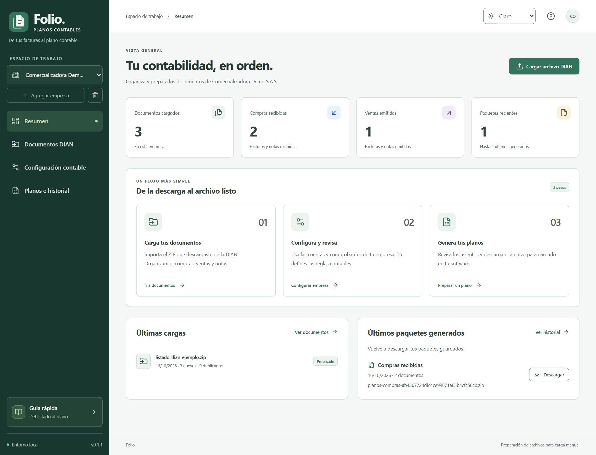
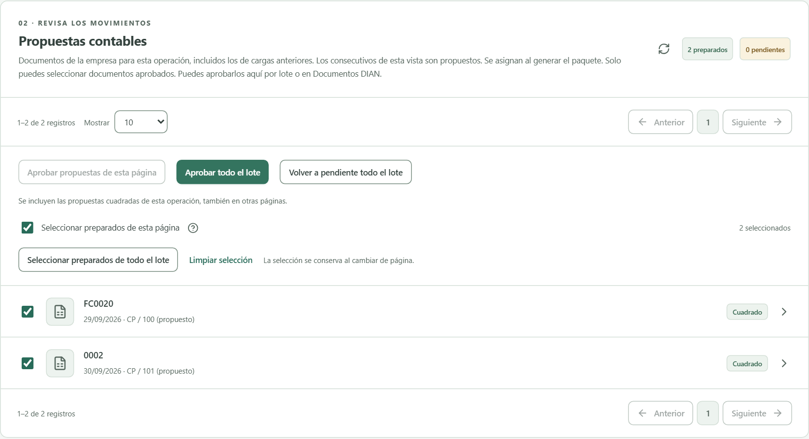
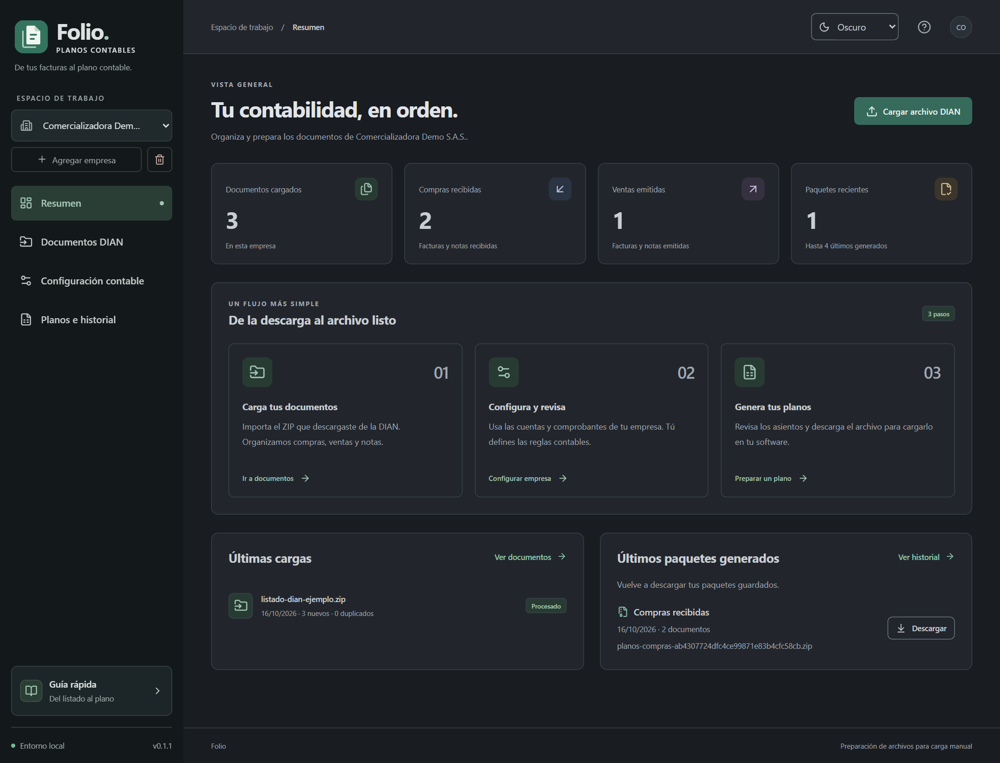

# Folio

**De tus facturas al plano contable.**

Proyecto personal de desarrollo y calidad de software de
[Santiago Atehortua Soto](https://www.linkedin.com/in/santiago-atehortua-soto-baa56a308/).

Folio organiza listados de documentos DIAN por empresa, permite revisar compras,
ventas y notas, y prepara archivos para importación manual en software contable.
Este repositorio presenta el producto, sus decisiones técnicas y su validación.
El código fuente se conserva en un repositorio privado.

**[Caso de estudio](docs/caso-de-estudio.md)** ·
**[Evidencia de validación](docs/validacion.md)** ·
**[Demo de presentación](https://folio-contable-demo.pausa-burnout.workers.dev)**

La demo requiere acceso entregado de forma privada. Las capturas permiten revisar
el proyecto sin solicitar credenciales. Todos los datos mostrados son ficticios.

## El problema

Preparar un listado de documentos para el importador contable exige distinguir
operaciones, revisar duplicados, configurar cuentas y comprobar los movimientos.
Folio reúne esas tareas en un flujo con revisión explícita y trazabilidad.

## Recorrido del producto

1. Crear o seleccionar una empresa.
2. Cargar el listado DIAN o un archivo compatible.
3. Revisar documentos, duplicados e incidencias.
4. Configurar cuentas, comprobantes, reglas y plantillas.
5. Revisar y aprobar propuestas que cumplen las validaciones.
6. Generar y descargar el paquete para su carga manual en el destino.

Una carga aceptada, una aprobación y un plano generado son estados diferentes.
La aplicación conserva el documento original separado de la decisión del operador.

## Tecnologías y responsabilidades

| Capa | Tecnología | Responsabilidad |
| --- | --- | --- |
| Interfaz | React, TypeScript, Vite | Cargas, configuración, revisión y descargas |
| API | Python, FastAPI | Contratos, operaciones y validaciones |
| Persistencia | PostgreSQL; SQLite para pruebas | Datos por empresa, historial y transacciones |
| Lectura y exportación | XML/UBL, ZIP, XLSX, CSV, openpyxl | Normalización y generación desde plantillas |
| Calidad | pytest, Playwright, Vitest, Ruff, Prettier | Pruebas funcionales, de interfaz y controles estáticos |
| Demo | Cloudflare Workers, Render, Neon | Presentación con acceso protegido |

## Aspectos que muestra este proyecto

- Modelado de documentos, empresas, decisiones e historial por separado.
- Importes con `Decimal` en el backend y cadenas decimales en los contratos web.
- Detección de duplicados por empresa y CUFE/CUDE, cuando están presentes.
- Trabajos de importación persistentes con progreso y recuperación.
- Revisión explícita, comprobación de partida doble y generación transaccional.
- Interfaz adaptable, temas claro y oscuro y ayudas contextuales.
- Pruebas de API, reglas de negocio, permisos de la demo y recorrido en navegador.
- Documentación del producto, límites y operación de la demostración.

## Validación del 7 de noviembre de 2026

| Comprobación ejecutada | Resultado |
| --- | --- |
| Suite Python | 255 pruebas correctas; 122 omitidas |
| Interfaz: modo demo/local y fallo de conexión | 2 pruebas Playwright correctas |
| Funciones de presentación de datos | 2 pruebas Vitest correctas |
| Puerta de acceso y proxy de la demo | 3 pruebas Node correctas |
| Ruff, TypeScript, compilación y formato | Correctos |
| Revisión de secretos | Historial y archivos preparados revisados |

Las pruebas omitidas requieren una base PostgreSQL de pruebas configurada. La
comprobación de navegador de esta revisión cubrió los dos escenarios indicados;
no equivale a ejecutar toda la suite de interfaz. Ver [alcance y límites](docs/validacion.md).

## Pantallas

### Revisión antes de generar

### Tema oscuro

Las capturas corresponden a la demo 0.1.1, con datos sintéticos del escenario
«Comercializadora Demo S.A.S.». Los códigos e importes son ilustrativos.

## Estado y límites

La generación implementada utiliza el modelo de comprobantes de 27 columnas para
Siigo Nube y Siigo Contador Nube. La aceptación dentro de una cuenta de Siigo está
pendiente de validación. Los adaptadores de Siigo Windows y Alegra y las conexiones
directas con proveedores forman parte del trabajo pendiente.

La demo no es un sistema contable completo ni acredita validación fiscal. El
acceso protegido de presentación no equivale a autenticación multiusuario con
permisos completos por empresa. No se deben cargar datos de clientes en la demo.

## Privacidad y contacto

Este repositorio contiene documentación y capturas revisadas. No incluye código
fuente, historial del repositorio privado, credenciales, bases de datos, documentos
reales ni plantillas de terceros. Ver [política de publicación](SECURITY.md).

Para conversar sobre el proyecto, su arquitectura o sus pruebas:
[perfil de LinkedIn](https://www.linkedin.com/in/santiago-atehortua-soto-baa56a308/).

© 2026 Santiago Atehortua Soto. Material de presentación; todos los derechos reservados.
Los nombres de proveedores identifican los destinos contemplados y no implican afiliación.
