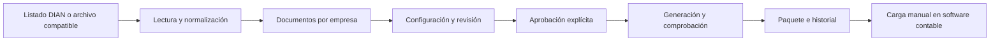

# Caso de estudio: Folio

## Contexto

Folio es un proyecto personal orientado a preparar documentos DIAN para un flujo
contable revisable. Su presentación permite examinar decisiones de desarrollo,
calidad de datos y pruebas sin publicar el código ni información de terceros.

## De la carga al resultado

El archivo se recibe, se identifica y se normaliza antes de presentarlo al operador.
La configuración contable pertenece a cada empresa. El operador revisa las
propuestas y decide su aprobación antes de solicitar el paquete de salida.

La descarga no confirma que el software de destino haya aceptado el archivo.
Esa validación externa se conserva como una responsabilidad posterior.

## Decisiones técnicas

| Decisión | Motivo |
| --- | --- |
| Monolito modular en FastAPI | Separar API, aplicación, dominio, lectura, almacenamiento y exportación |
| Documento original separado de revisión | Preservar la evidencia y distinguirla de decisiones contables |
| `Decimal` para importes | Evitar cálculos monetarios con punto flotante binario |
| Contratos con importes como texto decimal | Conservar precisión entre la API y la interfaz |
| Duplicados delimitados por empresa | Evitar confundir documentos entre contextos de trabajo |
| Operaciones de generación transaccionales | Mantener coherencia entre paquetes, consecutivos e historial |
| Datos sintéticos para demostrar y probar | Permitir reproducir escenarios sin divulgar documentos reales |

## Enfoque de QA

El proyecto contiene pruebas de lectores, documentos duplicados, reglas,
configuración contable, revisiones, generación, almacenamiento y contratos de API.
La interfaz dispone de pruebas de recorrido con Playwright; en esta revisión se
ejecutaron específicamente los escenarios de identificación del entorno y fallo
de conexión.

Entre los riesgos tratados se encuentran:

- Confundir una carga exitosa con aprobación o contabilización.
- Perder precisión en importes al atravesar API e interfaz.
- Generar un paquete con datos o reglas incompletos.
- Mostrar una conexión caída como si los datos estuvieran disponibles localmente.
- Publicar credenciales o documentos reales al compartir el proyecto.

La evidencia ejecutada y sus límites se registran en [validación](validacion.md).
Los resultados describen una revisión concreta y no constituyen una certificación
de seguridad ni una garantía de operación con datos reales.

## Demostración y operación

La presentación web utiliza un proxy autenticado delante de la API. El acceso se
entrega por un canal privado y las pantallas públicas muestran datos ficticios.

Existe un respaldo de presentación con API y PostgreSQL separados en el equipo
local. La selección entre ese origen y la nube es manual: no sincroniza bases ni
reintenta escrituras contra otro origen. Este mecanismo es de apoyo a la demo;
no constituye alta disponibilidad.

## Próximos pasos

- Validar una importación completa en el software contable de destino.
- Desarrollar los formatos pendientes a partir de especificaciones verificables.
- Integrar autenticación y permisos multiusuario completos.
- Ampliar la validación de despliegue y los recorridos automatizados.

## Autor

[Santiago Atehortua Soto en LinkedIn](https://www.linkedin.com/in/santiago-atehortua-soto-baa56a308/).
